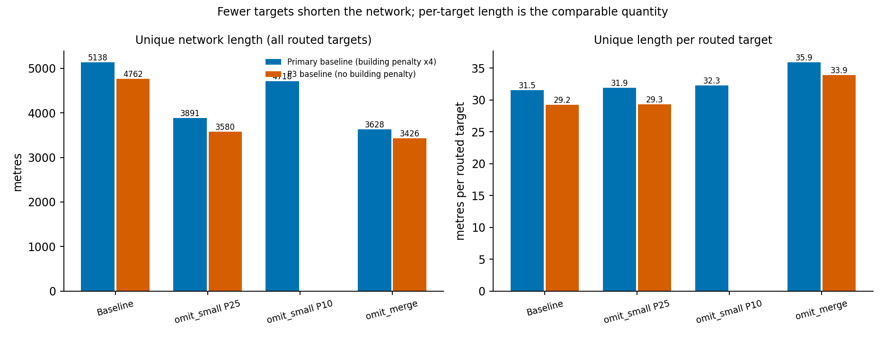
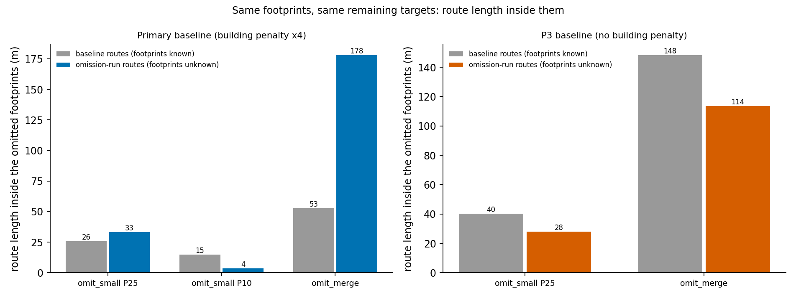

# C1 report: propagation of building-candidate omission into rural road-network planning

Village: Damarakunta, Siddipet, Telangana (EPSG:32644). Generated 2026-10-29 18:49 by `dk_stageB_c1_report_v4.py` from existing outputs only.

> All results below come from **deterministic candidate-omission scenarios** applied to a building-candidate layer. They are not measured segmentation false-negative rates, and nothing here is field-validated.

## 1. Research question and hypotheses

**Question (C1).** How does a missing set of building candidates change the road-network plan produced by the Stage B planner, compared with planning on the full candidate set?

Hypotheses as evaluated here (the exposure measure in H2 was adopted after an output audit, see section 10):

- **H1 (scale).** Omitting targets shortens the absolute network because fewer targets are connected; length per routed target is the comparable quantity.
- **H2 (exposure).** When a building penalty is used, omitting footprints from the planner input increases route length inside those footprints, because the penalty can no longer steer routes around them.
- **H3 (structure control).** With no penalty (P3) the planner ignores footprints, so any change in exposure then reflects network restructuring rather than lost penalty information.

## 2. Relation to the research gap

C1 is one of three planned contributions (C1 error propagation, C2 two-stage generate-and-select planner with shared-edge credit, C3 transfer only if supported). Generic A*, least-cost paths, AHP and facility prioritisation are not claimed as novel. This report supports C1 only, on one village.

## 3. Baselines and fixed parameters

**Primary baseline (building penalty x4)** - baseline run `S2_fac_C0_s25_v11`

| Argument | Value |
|---|---|
| allow_planner_change | False |
| attach_tol_m | 15.0 |
| building_mult | 4.0 |
| building_quality | PLAUSIBLE,REVIEW,UNRESOLVED_MERGE |
| c1_land_cost_json | None |
| cadastral | None |
| cadastral_original | None |
| check_only | False |
| corner_cut | forbid |
| corridor_m | 20.0 |
| corridor_mults | [3.0, 8.0] |
| cost_scenario | C0 |
| expect_facilities | 4 |
| expect_merged | 62 |
| expect_s1 | 101 |
| facilities | on |
| k | 3 |
| label | v11 |
| length_only_baseline | on |
| max_overlap | 0.8 |
| max_search_m | 1500.0 |
| passes | 2 |
| planner | None |
| project_root | D:\Telangana_Rural_Project |
| roads_only_reference | on |
| scenario | S2 |
| slope_limit_deg | 25.0 |
| snap_m | 30.0 |
| stagea_run | run_20261029_01 |
| v1_dir | None |
| village_root | None |

**P3 baseline (no building penalty)** - baseline run `S2_fac_C0_s25_P3_none`

| Argument | Value |
|---|---|
| add_max_m | 50.0 |
| add_min_m | 15.0 |
| allow_planner_change | False |
| attach_tol_m | 15.0 |
| building_mult | 1.0 |
| building_quality | PLAUSIBLE,REVIEW,UNRESOLVED_MERGE |
| c1_land_cost_json | None |
| cadastral | None |
| cadastral_original | None |
| check_only | False |
| corner_cut | forbid |
| corridor_m | 20.0 |
| corridor_mults | [3.0, 8.0] |
| cost_scenario | C0 |
| expect_facilities | 4 |
| expect_merged | 62 |
| expect_s1 | 101 |
| facilities | on |
| k | 3 |
| label | P3_none |
| length_only_baseline | on |
| max_overlap | 0.8 |
| max_search_m | 1500.0 |
| passes | 2 |
| perturb | none |
| perturb_frac | 0.0 |
| perturb_seed | 20261029 |
| planner | None |
| project_root | D:\Telangana_Rural_Project |
| roads_only_reference | on |
| scenario | S2 |
| slope_limit_deg | 25.0 |
| snap_m | 30.0 |
| stagea_run | run_20261029_01 |
| v1_dir | None |
| village_root | None |

Costs are ordinal model units, not money. Edge weight is the mean of the two cell costs times step length (10 m or 10*sqrt(2) m); the building penalty is a cell multiplier inside the cost grid. The two baselines are never mixed in one comparison.

### 3.1 Settings used in these runs and their status

| Setting | Value | Status |
|---|---|---|
| Cost scenario | C0 | Fixed: land-cover table `c0_land_cost` plus slope term, recorded in each config. The separate `C1` cost scenario (built-up cost 3.0, a provisional table in the runner) was NOT used (`c1_land_cost_json` = None); note that this `C1` is a cost scenario, unrelated to the contribution C1. |
| Slope limit (hard) | 25.0 deg | Fixed setting for all runs. |
| Building penalty | x4.0 on PLAUSIBLE,REVIEW,UNRESOLVED_MERGE | Design parameter (soft multiplier, not a fact). P3 repeats the experiment with multiplier 1.0. |
| Target and facility weights | 1.0 for every house and facility | Design choice set in the Stage B runner (source inspection: `dk_stageB_run_v1_3.py` lines 498 and 506); the planner's own default weights (health 4, school 3, government 2) are not used in Stage B. |
| Cadastral file | D:\Telangana_Rural_Project\Siddipet\Damarakunta\reference\damarakunta_cadastral_valid.gpkg | Used only for parcel-overlap metrics; routes do not depend on it. Repaired by make_valid; parcel counts are crossings of parcel units, not ownership. |
| Slope data | Sobel slope from a ~30 m DEM, resampled to 10 m | Not genuine 10 m terrain detail (noted in the run configs). |
| Costs | ordinal model units | Not money; no construction-cost claim is made. |

## 4. Perturbation definitions

| Baseline | Run | Rule | Omitted | Threshold (m2) |
|---|---|---|---|---|
| Primary | omit_merge | QUALITY_CLASS_UNRESOLVED_MERGE | 62 | n/a |
| Primary | omit_small P10 | SMALL_BUILDING area_m2<=P10=46.66 | 17 | 46.66 |
| Primary | omit_small P25 | SMALL_BUILDING area_m2<=P25=113.40 | 41 | 113.40 |
| P3 | omit_merge | QUALITY_CLASS_UNRESOLVED_MERGE | 62 | n/a |
| P3 | omit_small P25 | SMALL_BUILDING area_m2<=P25=113.40 | 41 | 113.40 |

- `omit_small`: targets with `area_m2` at or below the stated percentile of the scenario-target areas (163 targets) are removed.
- `omit_merge`: all targets whose `quality_class` is `UNRESOLVED_MERGE` are removed.
- The omitted footprints are also removed from the planner's building-penalty layer. Facilities are never omitted.
- These are **not** spatially clustered omissions and carry no random seed. The omitted groups are defined by footprint area or quality class, which may be spatially concentrated; that concentration was not designed or measured.

Omitted targets by quality class:

| Baseline | Run | Quality class | Omitted |
|---|---|---|---|
| Primary | omit_merge | UNRESOLVED_MERGE | 62 |
| Primary | omit_small P10 | PLAUSIBLE | 6 |
| Primary | omit_small P10 | REVIEW | 11 |
| Primary | omit_small P25 | PLAUSIBLE | 17 |
| Primary | omit_small P25 | REVIEW | 24 |
| P3 | omit_merge | UNRESOLVED_MERGE | 62 |
| P3 | omit_small P25 | PLAUSIBLE | 17 |
| P3 | omit_small P25 | REVIEW | 24 |

## 5. Reproducibility

The omission modes are deterministic; the `perturb_seed` value shown in the configs is not used by them. The runs record their arguments and version in each `config_stageB.json`; the command lines below are **reconstructed from the working session**, not machine-recorded:

```powershell
scripts\dk_stageB_run_v1_3.py --scenario S2 --perturb omit_small --small-pct 25      (also --small-pct 10)
scripts\dk_stageB_run_v1_3.py --scenario S2 --building-mult 1.0 --perturb omit_small --small-pct 25 --label P3_none
scripts\dk_stageB_run_v1_3.py --scenario S2 --building-mult 1.0 --perturb omit_merge --label P3_none
scripts\dk_stageB_run_v1_3.py --scenario S2 --perturb omit_merge
scripts\dk_stageB_c1_compare_v2.py --stageb-root $B --label c07fix_primary|c07fix_p3 --buildings <v8 buildings> --cost-raster <aligned cost surface> --baseline <baseline run> --runs <omission runs>
scripts\dk_stageB_c1_footprint_eval_v1.py --label fp_primary|fp_p3 ... --ref-comparison <c07fix folder>\c1_scenario_comparison.csv
scripts\dk_stageB_c1_omitted_exposure_v1.py --label ex_primary|ex_p3 ... --fp-summary <fp folder>\c1_footprint_crossings_full_set.csv
scripts\dk_stageB_c2_ablation_summary_v1.py --stageb-root $B --label abl_v1 --reference S2_fac_C0_s25_v11 --same-config-control S2_fac_C0_s25_K3_P2 --runs <K1_P0 K1_P2 K3_P0 K3_P2 run labels>
scripts\dk_stageB_c1_report_v4.py --stageb-root $B --label report_v4 --scripts-dir <scripts> --buildings <v8 buildings> --cost-raster <aligned cost surface> --v1-report <_c1_report_v1>\C1_report.md --c2-abl _c2_abl_v1
```

### 5.1 Runner versions and comparability

| Run | Recorded runner version |
|---|---|
| S2_fac_C0_s25_v11 | dk_stageB_run v1.1 |
| S2_fac_C0_s25_P3_none | dk_stageB_run v1.2 |
| omit_small P25 (Primary) | dk_stageB_run v1.3 |
| omit_small P10 (Primary) | dk_stageB_run v1.3 |
| omit_merge (Primary) | dk_stageB_run v1.3 |
| omit_small P25 (P3) | dk_stageB_run v1.3 |
| omit_merge (P3) | dk_stageB_run v1.3 |

Source comparison of the three runner scripts (hashes below): v1.1 to v1.2 adds the `--perturb`, `--perturb-frac`, `--perturb-seed`, `--add-min-m` and `--add-max-m` options and code gated by `--perturb != none`, plus lookups guarded by an index test that is always true for real candidates. v1.2 to v1.3 adds the `omit_small` and `omit_merge` modes, `--small-pct`, and branches gated by those modes. No change to routing, cost, penalty or evaluation code was found for `--perturb none`. The check C06 compared every baseline configuration key except the perturbation, label and path keys, and found no difference. **Empirical check:** the v1.3 runner was re-run with `--perturb none` and the primary-baseline settings (k=3, passes=2; run `S2_fac_C0_s25_K3_P2`). Its house and facility route geometries are identical to the primary baseline run recorded by v1.1 (163/163 identical; counts 163 vs 163; 4/4 identical; counts 4 vs 4) and its unique and total house lengths differ by 0 m (checks R01 to R03, Appendix A). **Still not verified:** an empirical re-run of the P3 baseline (recorded by v1.2); for it the conclusion rests on the static source comparison only.

Script versions (SHA-256 at report build time):

| Script | SHA-256 |
|---|---|
| dk_stageB_run_v1_1.py | 48b87aa4c7d41a064566537dede74e2bf831ef8916eefba6500235c610fd9b2a |
| dk_stageB_run_v1_2.py | 1fc317dc9074b721d6682805c51011baa2d35eda1c4590a9f08dfc26cf0ac525 |
| dk_stageB_run_v1_3.py | 3122d2d99f4af30a014a8f0ab669d4023d96649306942cefb69ad8789d211688 |
| plan_network_v2.py | d00ea92028101131627b8592e3df2c33ff350efac9b1de09f9b64cdd56ef70a4 |
| dk_stageB_c1_compare.py | b21acba77854aadc0fd413ab8828d2bc7a0ec90258f32b43f1e957b05f1b10cf |
| dk_stageB_c1_compare_v2.py | 1d8ca573ec537d2b197fa862f55e6f728feb29b22fcd2c3d1b57980c8169840d |
| dk_stageB_c1_c07.py | e74d50efeeb40a44425af167f00ed6eb2126d152dc8698b149fe3759910b85a7 |
| dk_stageB_c1_test_c07.py | fe96e2415beb59585025bed341e2c05493f64fa1f3cc2c120c2fef30e241bad0 |
| dk_stageB_c1_diag_facility.py | 28ffcccf19a0c01d4c83fe55b94ed508b02eaa154a581a794c1817c235f0a188 |
| dk_stageB_c1_diag_facility_costs_v2.py | d7bed5b6fa639d05119bea558f5735b9c39f02174af336adf8753b6206313087 |
| dk_stageB_c1_footprint_eval_v1.py | 1abcaca52cc32fd9550df3008749b33ac36c8200cacda11265507ae529fc00d9 |
| dk_stageB_c1_test_footprint_eval.py | b481b95942f61856fcbb3880895cc67ca01fec9d009919d0736747f8a3a8a9b0 |
| dk_stageB_c1_omitted_exposure_v1.py | e7b415809ffdd91216e2b119ec38a73d6ea19897de9e87625ddb6dd9dedb0b0c |
| dk_stageB_c1_report_v1.py | ec05ef725da5c227106d7d9f2867e0d14bfb8c39036735017c72fcb8da8975cc |
| dk_stageB_c1_report_v2.py | 94514cb402bf51080b5a2d4bc366941f5da6a9b7841c89840ab4d103a6123983 |
| dk_stageB_c2_ablation_summary_v1.py | a6ac7b4faddae7355e43cecbf11a6160789785cb91a8b9901a3017017715d9a3 |
| dk_stageB_c1_report_v3.py | e95200c7ab07564dd2d35e7ca91ab7b2bf3d376c1f0277735dc2060c1677c2ac |
| dk_stageB_c1_report_v4.py | ef14609eadefd16cb363e96e23921a7ee52e11d8e4e7f422ddc2329a1e2bf45e |

Buildings input: `D:\Telangana_Rural_Project\Siddipet\Damarakunta\results\v8_instances\buildings_v8_full.gpkg` SHA-256 `0eae82fea8ada939167253a1cd147e52f26320544113be39e7c2d6e1fb815b47`

Cost raster input: `D:\Telangana_Rural_Project\Siddipet\Damarakunta\aligned\damarakunta_cost_surface_10m.tif` SHA-256 `911ebeb1860aa49f7a701e28e54850a009dff365a11b564dfc42602043b4888e`

### 5.2 Input provenance and licence status

- Building candidates (`buildings_v8_full.gpkg`) are model-derived polygons extracted from a high-resolution imagery mosaic; they are unverified candidates, not surveyed buildings.
- The mosaic was assembled on 4 Oct 2026 from Esri World Imagery map-export requests. The project document `DAMARAKUNTA_STAGE_B_C_PROPOSALS.md` records that the licence for this use is **not verified** (storage, inference, derived maps, publication and sharing are undetermined). Nothing in this report is licence-cleared.
- Reference roads, facilities and cadastral data are used as provided in the project folders; their provenance is documented in the project data-source notes, not re-verified here.

## 6. Results

### 6.1 Primary baseline (building penalty x4)

| Run | Original | Omitted | Remaining | Routed | Genuine failures | Not in main comp. | Unique length (m) | Change (%) | Per routed (m) | Change per routed (%) | Shared-edge credit (%) | Facility unique (m) |
|---|---|---|---|---|---|---|---|---|---|---|---|---|
| Baseline | 163 | 0 | 163 | 163 | 0 | 1 | 5137.71 | 0.00 | 31.52 | 0.00 | 23.95 | 311.34 |
| omit_small P25 | 163 | 41 | 122 | 122 | 0 | 0 | 3890.60 | -24.27 | 31.89 | 1.18 | 23.75 | 311.34 |
| omit_small P10 | 163 | 17 | 146 | 146 | 0 | 1 | 4717.53 | -8.18 | 32.31 | 2.51 | 23.83 | 311.34 |
| omit_merge | 163 | 62 | 101 | 101 | 0 | 1 | 3627.87 | -29.39 | 35.92 | 13.96 | 25.67 | 303.72 |

### 6.2 P3 baseline (no building penalty)

| Run | Original | Omitted | Remaining | Routed | Genuine failures | Not in main comp. | Unique length (m) | Change (%) | Per routed (m) | Change per routed (%) | Shared-edge credit (%) | Facility unique (m) |
|---|---|---|---|---|---|---|---|---|---|---|---|---|
| Baseline | 163 | 0 | 163 | 163 | 0 | 1 | 4761.73 | 0.00 | 29.21 | 0.00 | 31.22 | 291.34 |
| omit_small P25 | 163 | 41 | 122 | 122 | 0 | 0 | 3580.23 | -24.81 | 29.35 | 0.46 | 29.37 | 291.34 |
| omit_merge | 163 | 62 | 101 | 101 | 0 | 1 | 3425.66 | -28.06 | 33.92 | 16.10 | 29.64 | 291.34 |

## 7. Absolute versus per-routed-target change

Absolute network length falls whenever targets are omitted, because fewer targets are connected. A shorter network is therefore **not** evidence of efficiency. Compare length per routed target (the `Per routed` column) and the shared-edge credit. Route-count metrics (routes crossing footprints) and route-length metrics (metres inside footprints) are reported separately and must not be mixed.

- Primary baseline (building penalty x4), omit_small P25: unique length fell from 5137.71 m to 3890.60 m; per routed target rose from 31.52 m to 31.89 m.
- Primary baseline (building penalty x4), omit_small P10: unique length fell from 5137.71 m to 4717.53 m; per routed target rose from 31.52 m to 32.31 m.
- Primary baseline (building penalty x4), omit_merge: unique length fell from 5137.71 m to 3627.87 m; per routed target rose from 31.52 m to 35.92 m.
- P3 baseline (no building penalty), omit_small P25: unique length fell from 4761.73 m to 3580.23 m; per routed target rose from 29.21 m to 29.35 m.
- P3 baseline (no building penalty), omit_merge: unique length fell from 4761.73 m to 3425.66 m; per routed target rose from 29.21 m to 33.92 m.

## 8. Connectivity and non-main-component targets

Genuine routing failures are 0 in every run. Omitted targets are not counted as failures. The non-main-component count refers to targets whose route attaches to a road component other than the main one:

**Primary baseline (building penalty x4)**

| run | cand_id | v1_house_id | quality_class | attach_class | road_component | route_len_m |
|---|---|---|---|---|---|---|
| Baseline | 2 | H0001 | REVIEW | ROAD | 10 | 105.9 |
| omit_small P10 | 2 | H0001 | REVIEW | ROAD | 10 | 105.9 |
| omit_merge | 2 | H0001 | REVIEW | ROAD | 10 | 105.9 |

**P3 baseline (no building penalty)**

| run | cand_id | v1_house_id | quality_class | attach_class | road_component | route_len_m |
|---|---|---|---|---|---|---|
| Baseline | 2 | H0001 | REVIEW | ROAD | 10 | 105.9 |
| omit_merge | 2 | H0001 | REVIEW | ROAD | 10 | 105.9 |

A change in this count between runs can occur only because the affected target was itself omitted; it is not evidence of improved connectivity.

## 9. Facility-route invariance test and its resolution

The original check C07 assumed facility routes cannot change because facilities are planned first. In the primary omit_merge run it warned (facility unique length 303.72 m vs 311.34 m). Diagnosis (read-only): omitted footprints are also removed from the penalty layer, which changes the cost surface the facility routes are planned on; the two changed routes pass through cells whose penalty was removed, and the baseline routes pass through none. Corrected check (`dk_stageB_c1_c07.py`): PASS if geometry is identical; INFO only if geometry changed AND the new route uses removed-penalty cells AND the cost reconstruction calibrates AND the new route is not costlier than the old on the new surface; otherwise FAIL.

Primary baseline (building penalty x4): C07 PASS 10, INFO 2, other 0.

- `C07 S2_fac_C0_s25_omitmerge` facility route 36181600903: unchanged, or changed with removed-penalty-cell evidence - geometry changed (Hausdorff 20.000 m); new route uses 24.14 m of cells whose penalty was removed; cost on the new surface 109.721 <= old route 153.378
- `C07 S2_fac_C0_s25_omitmerge` facility route HEALTH_8734223673: unchanged, or changed with removed-penalty-cell evidence - geometry changed (Hausdorff 28.284 m); new route uses 44.14 m of cells whose penalty was removed; cost on the new surface 256.511 <= old route 357.692

P3 baseline (no building penalty): C07 PASS 8, INFO 0, other 0.


Costs on the two surfaces are not comparable for changed routes; report the facility change as geometry and length only. It is not evidence that omission improves facility planning.

## 10. Route-footprint interaction

**Audit finding.** The runner scores routes against its own (reduced) footprint set, so in omission runs the omitted footprints are invisible to its crossing metrics. Those columns (`retained`) are reported only for reproducibility and are **not comparable** with the baseline. All comparisons below score every run's saved routes against the full footprint set (`dk_stageB_c1_footprint_eval_v1.py`); that script reproduces the runner's own numbers exactly for the retained footprints (checks F01-F03 PASS). The runner's `net_len_penalised_cells_m` is measured against each run's own penalty mask and is likewise excluded from the conclusions.

### 10.1 Crossings against the full footprint set - Primary baseline (building penalty x4)

| Run | Routed | Routes crossing any footprint | Rate per routed | Length in footprints (m) | Length per routed (m) | Routes crossing omitted | Length in omitted (m) | Routes crossing retained (runner metric) | Length in retained (m, runner metric) |
|---|---|---|---|---|---|---|---|---|---|
| Baseline | 163 | 29 | 0.178 | 216.11 | 1.33 | 0 | 0.00 | 29 | 216.11 |
| omit_small P25 | 122 | 25 | 0.205 | 198.08 | 1.62 | 6 | 33.31 | 20 | 164.77 |
| omit_small P10 | 146 | 27 | 0.185 | 213.27 | 1.46 | 1 | 3.60 | 26 | 209.67 |
| omit_merge | 101 | 32 | 0.317 | 271.37 | 2.69 | 17 | 177.99 | 16 | 93.37 |

### 10.2 Crossings against the full footprint set - P3 baseline (no building penalty)

| Run | Routed | Routes crossing any footprint | Rate per routed | Length in footprints (m) | Length per routed (m) | Routes crossing omitted | Length in omitted (m) | Routes crossing retained (runner metric) | Length in retained (m, runner metric) |
|---|---|---|---|---|---|---|---|---|---|
| Baseline | 163 | 57 | 0.350 | 665.98 | 4.09 | 0 | 0.00 | 57 | 665.98 |
| omit_small P25 | 122 | 45 | 0.369 | 637.07 | 5.22 | 5 | 27.94 | 41 | 609.13 |
| omit_merge | 101 | 37 | 0.366 | 351.71 | 3.48 | 9 | 113.53 | 31 | 238.18 |

### 10.3 Controlled contrast on identical footprints

For each scenario: route length inside the footprints that scenario omits, for the baseline routes of the same remaining targets (footprints known to the planner) versus the omission run (footprints unknown). Per-target segments depend on shared-edge attribution, so compare totals, not individual routes.

**Primary baseline (building penalty x4)**

| Run | Omitted footprints | Retained targets | Baseline routes crossing | Baseline length (m) | Omission routes crossing | Omission length (m) | Delta (m) |
|---|---|---|---|---|---|---|---|
| omit_small P25 | 41 | 122 | 4 | 25.86 | 6 | 33.31 | +7.45 |
| omit_small P10 | 17 | 146 | 3 | 14.95 | 1 | 3.60 | -11.35 |
| omit_merge | 62 | 101 | 4 | 52.60 | 17 | 177.99 | +125.40 |

**P3 baseline (no building penalty)**

| Run | Omitted footprints | Retained targets | Baseline routes crossing | Baseline length (m) | Omission routes crossing | Omission length (m) | Delta (m) |
|---|---|---|---|---|---|---|---|
| omit_small P25 | 41 | 122 | 7 | 40.18 | 5 | 27.94 | -12.25 |
| omit_merge | 62 | 101 | 12 | 148.28 | 9 | 113.53 | -34.75 |

- Primary, omit_merge: length inside omitted footprints rose from 52.60 m to 177.99 m (routes crossing: 4 in the baseline routes, 17 in the omission run).
- Primary, omit_small P25: length inside omitted footprints rose from 25.86 m to 33.31 m (routes crossing: 4 in the baseline routes, 6 in the omission run).
- Primary, omit_small P10: length inside omitted footprints fell from 14.95 m to 3.60 m (routes crossing: 3 in the baseline routes, 1 in the omission run).
- P3 (no penalty), omit_small P25: fell from 40.18 m to 27.94 m - this is the structural component only, since the planner ignores footprints in P3.
- P3 (no penalty), omit_merge: fell from 148.28 m to 113.53 m - this is the structural component only, since the planner ignores footprints in P3.

Indicative decomposition (not a causal estimate; one deterministic scenario per mode): primary delta minus P3 delta.

| Scenario | Primary delta (m) | P3 delta (m) | Difference (m) |
|---|---|---|---|
| omit_small P25 | +7.45 | -12.25 | +19.70 |
| omit_merge | +125.40 | -34.75 | +160.15 |

## 11. Figures



*Figure 1. Unique network length (left) and unique length per routed target (right) for each baseline and omission scenario. Absolute length falls mainly because fewer targets are connected; per-routed length is the comparable quantity. Source: `c1_scenario_comparison.csv` in the two compare folders.*



*Figure 2. Route length inside the footprints each scenario omits, for the baseline routes of the same remaining targets (footprints known) and for the omission-run routes (footprints unknown). One deterministic scenario per mode; not an effect size. Source: `c1_omitted_footprint_exposure.csv`.*

Both figures are generated from the CSV outputs listed in the manifest.

## 12. Limitations and threats to validity

- One village, one deterministic scenario per mode, no repeats: differences are descriptive, not statistical.
- Omission is simulated on candidate footprints; it is not a measured detector false-negative rate and does not reflect real error structure.
- 'Crossing' means a route geometry intersects a candidate footprint polygon. Candidates are unverified; this says nothing about legal access, passability or real damage.
- Routes are planning proxies. Costs are ordinal model units, not construction cost. Slope comes from a ~30 m DEM resampled to 10 m.
- Omitted groups differ in size and location (merged candidates are the largest and probably spatially concentrated; this was not measured), and the omitted targets were themselves part of the baseline network, so rate comparisons mix target composition with footprint knowledge.
- Shared-edge attribution differs between runs; per-target segments are not individually comparable.
- The slope >10 degrees and repaired-parcel lengths rest on a handful of cells and are not interpreted.
- The building-penalty multiplier (x4) and the penalised class set are design parameters, not facts; equal target weights (1.0) are likewise a design choice. None has been confirmed against reference data (section 3.1).
- The baselines and omission runs were produced by different recorded runner versions (section 5.1). The primary baseline was reproduced exactly by v1.3 (Appendix A); the P3 baseline (v1.2) was not re-run and rests on a static source comparison.
- Input imagery licence: the Esri World Imagery mosaic used to derive the building candidates has an unverified licence status (project document `DAMARAKUNTA_STAGE_B_C_PROPOSALS.md`, Part B). Derived maps and footprints must not be described as licence-cleared.

## 13. Conclusions

**Supported by these experiments**

- In the primary baseline (one village, one deterministic scenario), the route length inside the omitted UNRESOLVED_MERGE footprints rose from 52.60 m to 177.99 m when the planner no longer knew those footprints; the number of routes crossing them went from 4 to 17. The same measure fell under P3, where the planner ignores footprints (section 10.3).
- Absolute network length falls with omission mainly because fewer targets are connected; per-routed-target length is the comparable quantity (section 7).
- The runner's own crossing metrics are not comparable across omission runs and were replaced by full-set scoring (section 10).
- Facility-route differences in the primary omit_merge run are attributable to removed-penalty cells (section 9).
- The primary baseline is reproduced exactly (route geometry and lengths) by runner v1.3 with `--perturb none` (Appendix A).

**Not supported**

- Any measured segmentation false-negative rate, detector accuracy, or field validation.
- Claims of legal access, passability, real construction cost or savings.
- That a shorter network after omission is more efficient.
- A general effect size for omission: the scenarios are single, deterministic and from one village.
- C3 (transfer): no second village has been run.

## 14. Manifest of files

SHA-256 of every input file used (comparison, footprint and exposure folders). Files in this report folder are listed in `manifest_report_files.csv`.

| File | Bytes | SHA-256 |
|---|---|---|
| _c1_c07fix_primary\c1_comparison.png | 81124 | 1cfadf258cf8f6349d0355188667f301851a59a5bcea101dad0836a49a398cf5 |
| _c1_c07fix_primary\c1_scenario_comparison.csv | 3887 | c876f5c12ccb802671333684b465c62c423c09c77e564792376e6db407666531 |
| _c1_c07fix_primary\c1_summary.md | 1921 | da8dc694d563ef2da74fd4220615712a2ee72e8a2d26c30b959ea76d26d9f2e0 |
| _c1_c07fix_primary\c1_validation.csv | 3754 | b9bf8caaac0369544306ccb1d940ab97e8efcee287cbe7d7d9781ee89c9cbe4f |
| _c1_c07fix_primary\non_main_component_targets.csv | 276 | 27b04a3aea3b250b208c9aa1a6911ae3d61b99c335b4f8c58f15ce1f4c025f43 |
| _c1_c07fix_primary\omitted_candidates.csv | 15088 | 381fd4fb1c72e9753c4531e26b9f5271b32ed9d2aa35a91d3b72f42c65a30734 |
| _c1_fp_primary\c1_footprint_crossings_full_set.csv | 665 | 171498e168a37fcb62141a32969d39a58afafdaccd874993340a089c31a7540e |
| _c1_fp_primary\c1_footprint_crossings_per_route.csv | 32717 | 3c0c90e1f7e7a09d345cc4f9351ed5279106f1e1f3ecde7a0aff582ae0703f40 |
| _c1_fp_primary\c1_footprint_validation.csv | 961 | f27fd0de65086e65e9822484acdca310bee0b0e631829344e581905e007cd078 |
| _c1_ex_primary\c1_exposure_validation.csv | 569 | 3a4278fcec517cfe8c31ff4abb731fcbfc154ffaa3b216ea71cbb6902312bcd7 |
| _c1_ex_primary\c1_omitted_footprint_exposure.csv | 687 | 02efdaa7a216f99d9ec4fa45c840b1e0702ce2e5d8bbd7a51e17569ec9f34bf7 |
| _c1_c07fix_p3\c1_comparison.png | 82724 | 15b89fd1a8d408c10f6e043246045c383a73c2450c73e56e5da3495e2a00656a |
| _c1_c07fix_p3\c1_scenario_comparison.csv | 3128 | 308c7b3932d29de911d82a35516f2d67d0d05b3c07c2bb519a4b541e5df33b4e |
| _c1_c07fix_p3\c1_summary.md | 1675 | 7fd6a8b429651d95d25241e5c313284eff36c8e3f84e0fc78e6640d897f31abb |
| _c1_c07fix_p3\c1_validation.csv | 2515 | 12a75415dc638532d7d54de546d883b52bcdabc4ac5f27b2aead00d8b432102f |
| _c1_c07fix_p3\non_main_component_targets.csv | 219 | 101b28da1836a6e832e515c7dfb76a978c36aa8c73a066e63eb5a81721417612 |
| _c1_c07fix_p3\omitted_candidates.csv | 13778 | 3b1337f52398c919dfbf93e48c53c68329284d980cdb8c6d9bab0dcb169aaf23 |
| _c1_fp_p3\c1_footprint_crossings_full_set.csv | 554 | f4ef07eb6c9d543ea65bbd0ca3e4251efb443df899d739efe6b269f987a582ff |
| _c1_fp_p3\c1_footprint_crossings_per_route.csv | 26544 | 29e3e0afb2e40d72cc2e5994085f7b5b61cf1d9d144d2a0d0239d1a139a46bc8 |
| _c1_fp_p3\c1_footprint_validation.csv | 783 | c43bd3648692d9146a2a338c16c0b065bc522e991c11d27c7b634bde1bd3c9d5 |
| _c1_ex_p3\c1_exposure_validation.csv | 418 | dbb2567a99eb17c2cdd9b29446f1209bccab7b02d0ced99fde1820ea2d542277 |
| _c1_ex_p3\c1_omitted_footprint_exposure.csv | 580 | d68a192381b4263ad26afefb3d6bf2d30a5e5f764214062ed2df83b47ff08685 |


## Appendix A. Runner reproduction and C2 ablation (supporting evidence, not a C1 result)

Source: `_c2_abl_v1` (`dk_stageB_c2_ablation_summary_v1.py`, read-only on existing run folders). The first row is the original primary baseline (v1.1); the rest are v1.3 runs with `--perturb none` and the same settings except K and leaf-reroute passes.

| Run | Runner | K | Passes | Houses routed | House unique length (m) | House total length (m) | Shared-edge credit (%) | Facility unique (m) | Houses identical to K3_P2 | Facilities identical to K3_P2 |
|---|---|---|---|---|---|---|---|---|---|---|
| v11 | dk_stageB_run v1.1 | 3 | 2 | 163 | 5137.706 | 5137.763 | 23.946 | 311.34 | 163/163 | 4/4 |
| K3_P2 | dk_stageB_run v1.3 | 3 | 2 | 163 | 5137.706 | 5137.763 | 23.946 | 311.34 | 163/163 | 4/4 |
| K1_P0 | dk_stageB_run v1.3 | 1 | 0 | 163 | 5147.981 | 5148.042 | 23.794 | 311.34 | 161/163 | 4/4 |
| K1_P2 | dk_stageB_run v1.3 | 1 | 2 | 163 | 5137.706 | 5137.763 | 23.946 | 311.34 | 163/163 | 4/4 |
| K3_P0 | dk_stageB_run v1.3 | 3 | 0 | 163 | 5147.981 | 5148.042 | 23.794 | 311.34 | 161/163 | 4/4 |

Checks (`c2_ablation_validation.csv`):

| id | status | name | detail |
|---|---|---|---|
| R01 houses | PASS | S2_fac_C0_s25_K3_P2 routes identical to S2_fac_C0_s25_v11 (houses) | 163/163 identical; counts 163 vs 163 |
| R01 facilities | PASS | S2_fac_C0_s25_K3_P2 routes identical to S2_fac_C0_s25_v11 (facilities) | 4/4 identical; counts 4 vs 4 |
| R02 unique_len_m | PASS | house unique/total length equal to reference | abs diff 0.000000000 m |
| R02 total_len_m | PASS | house unique/total length equal to reference | abs diff 0.000000000 m |
| R03 | PASS | control uses the same k and passes as the reference | n/a |

- R01 compares each target route geometry of the same-settings v1.3 control with the v1.1 baseline (Hausdorff distance at most 1e-6 m). R02 compares house unique and total length. R03 confirms the same K and passes. They validate reproduction of the primary baseline only.
- Two leaf-reroute passes versus none: house unique length fell from 5147.981 m to 5137.706 m in this village (a difference of 10.274 m; with passes = 0 the house geometries matching the K3_P2 control are: 161/163).
- K = 1 and K = 3 give equal lengths and equal agreement with the control at each pass setting. The row-by-row comparison of their `selection_summary.csv` files (identical for K1 vs K3 at both pass settings) was done outside this generator; pairwise geometry identity of K1 and K3 was not tested.
- Deterministic results for one village and one scenario: this does not show that leaf rerouting is generally superior or that larger K is generally useless.
